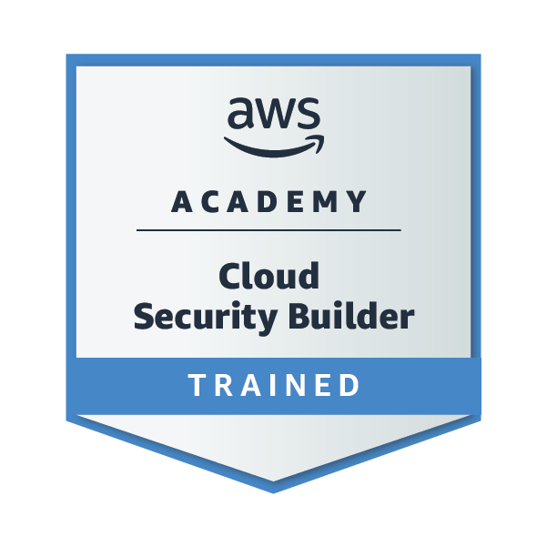
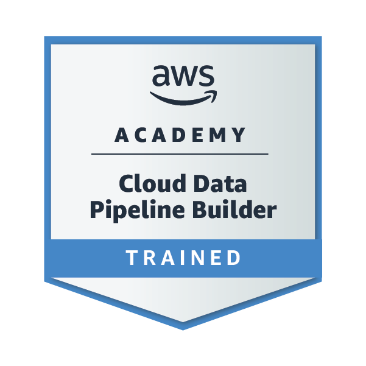
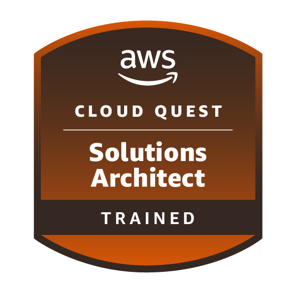
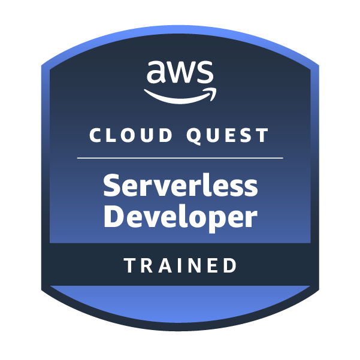
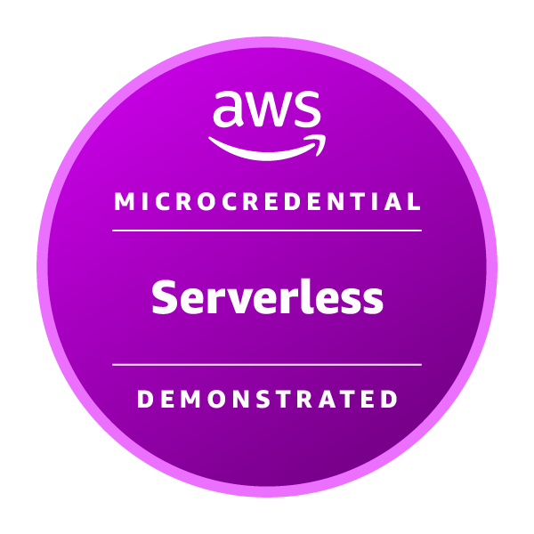
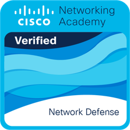

<div align="center">
  
</div>


```lua
pablinrlq@GitHub
▔▔▔▔▔▔▔▔▔▔▔▔▔▔▔▔
Nome:      Pablo Moises
Local:     Minas Gerais, Brasil
Foco:      Full-stack (React + Node) e Cloud (AWS)
Cert:      AWS Solutions Architect – Associate
Estudando: C#, segurança em nuvem e arquitetura de sistemas
Hobbies:   Jiu-Jitsu, programar e dormir
```

<br clear="right"/>

### Stack

<p>
  
</p>

### Projetos em destaque

| Projeto | O que é | Stack |
| --- | --- | --- |
| [**KRIÔ**](https://github.com/pablinrlq/krio) | Plataforma de casting: marcas, creators, match e chat em tempo real | React · Hono · PostgreSQL · Docker |
| [**Lokvia**](https://github.com/pablinrlq/Lokvia) | Marketplace de espaços para nômades digitais, com camada B2B | React · TypeScript · Supabase |
| [**pablin-cli**](https://github.com/pablinrlq/pablin-cli) | Interface de terminal guiada para a AWS CLI, publicada no PyPI | Python · Textual · AWS |
| [**CloudPipeLineCoffe**](https://github.com/pablinrlq/CloudPipeLineCoffe) | Pipeline de clickstream com análise de custo na AWS | EC2 · CloudWatch · S3 · IAM |
| [**ChatBot PDF**](https://github.com/pablinrlq/ChatBot-PDF) | Converse com PDFs usando RAG | Python · LangChain · FAISS · Gemini |
| [**Docker para Leigos**](https://github.com/pablinrlq/dockerparaleigos) | App Flask em container publicado numa EC2 | Docker · Flask · Amazon Linux |

<sub>Mais: [previsão de vendas com ML](https://github.com/pablinrlq/Machine-Learning) · [monitoramento de temperatura em C#](https://github.com/pablinrlq/SistemaMonitoramento)</sub>

### Certificações

<p align="center">
  <a href="https://www.credly.com/badges/d54eb0bf-e922-4f8d-a3f9-d40d376d9102/public_url"></a>
</p>

<p align="center">
  <a href="https://www.credly.com/badges/de31f9de-2170-4bf2-ac12-951231eb2674/public_url"></a>
  <a href="https://www.credly.com/badges/37f6cb9a-e19a-4ccf-919f-26224a9abffc/public_url"></a>
  <a href="https://www.credly.com/badges/bae1140d-dc07-460e-943f-d5246b6937e4/public_url"></a>
  <a href="https://www.credly.com/badges/f6adb149-ea6e-43cd-91d1-4825095d6638/public_url"></a>
  <a href="https://www.credly.com/badges/95cf9d0b-589a-41a8-9b2b-1754e408ea26/public_url"></a>
  <a href="https://www.credly.com/badges/a73b7b97-0a4b-4dbd-a07e-426ad5150a46/public_url"></a>
</p>

<p align="center"><sub>Clique em um badge para verificar no Credly</sub></p>

### Contato

<a href="https://www.linkedin.com/in/pablindev/"></a>

<br/>

<div align="center">
  
</div>


